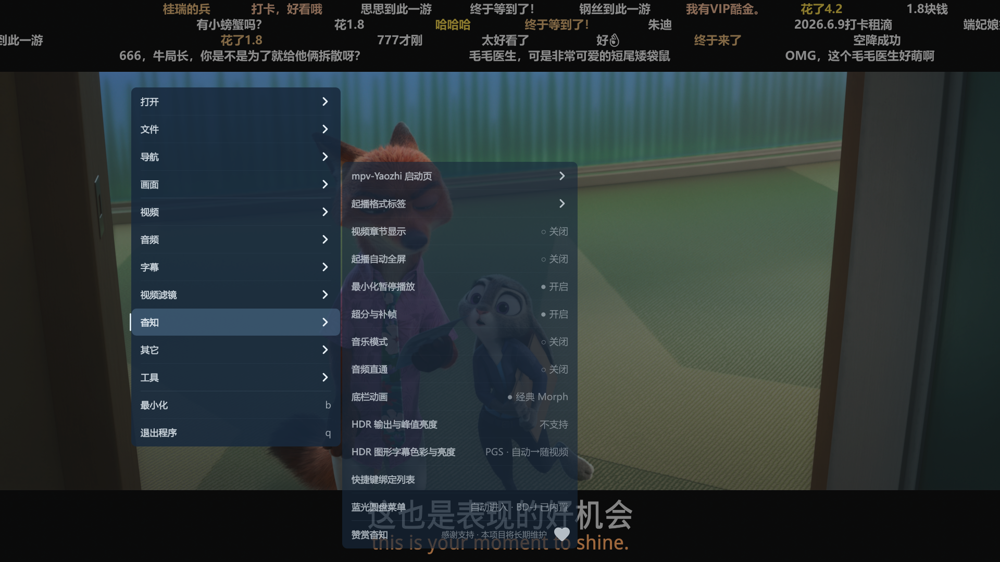
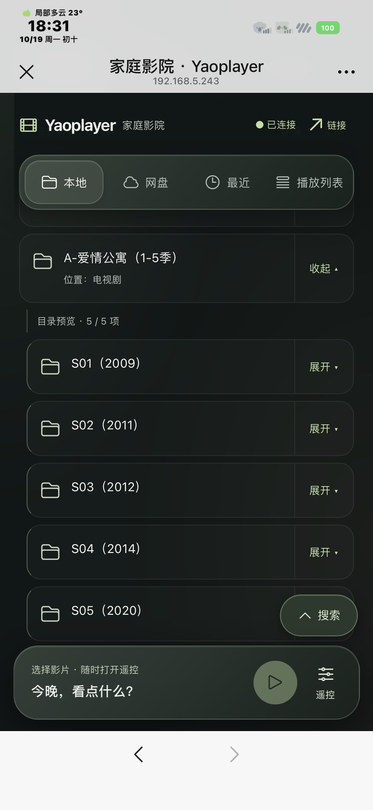
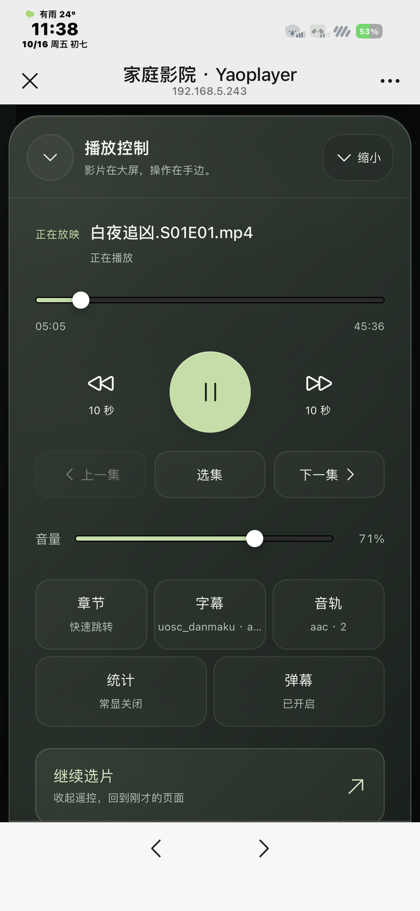
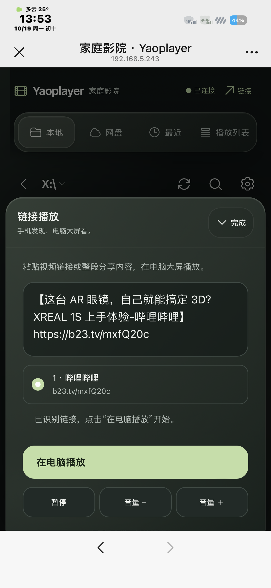
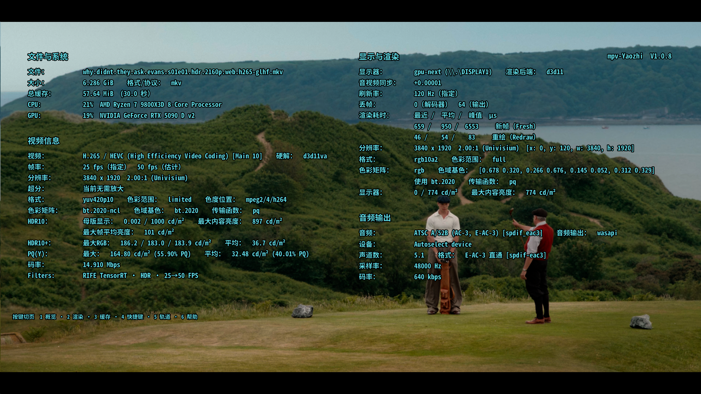
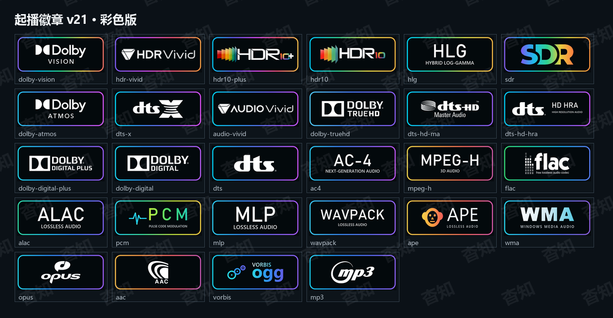
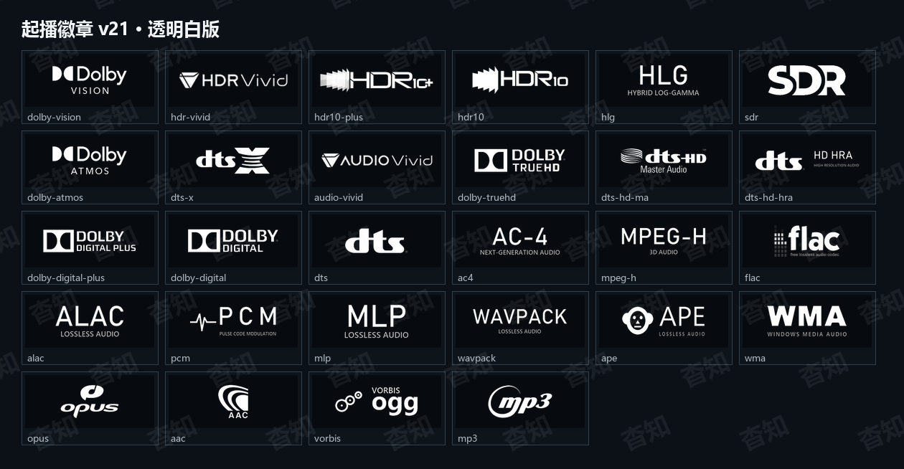

<h1>mpv-Yaozhi</h1>

**面向 Windows 的高画质播放器，让原盘、在线观影与中文操作更省心。**

 &nbsp; 

查看更多播放界面与配置助手

### 播放界面

### 杳知功能菜单

### 杳知配置助手

## 近期精选

> 以下包含近期内测功能展示；公开下载版本所含功能以对应发行说明为准。

- **手机家庭影院（内测）**：用手机浏览本地与网盘影片、遥控播放，或把支持的视频链接发给电脑，坐在沙发上也能轻松选片。
- **AI 补帧更省心**：开启后按当前片源检测，满足条件再自动接入；实际后端与帧率清晰可见，持续过载时安全回退。
- **三源在线字幕**：Assrt、迅雷、字幕猫统一搜索，可编辑关键词，换源时保留搜索内容。
- **在线追剧更顺手**：优化 YouTube 高清档位与清晰度切换；B站番剧支持在当前季列表按集号或标题查找。

## 手机家庭影院（内测）

手机与电脑在同一局域网内，即可浏览影片、控制播放和发送链接。把选片与操作留在手边，让大屏专心播放。

<strong>影片在大屏，操作在手边。</strong>

  
  
  

手机选片 · 播放遥控 · 链接播放 真实手机截图，点击可放大查看。

浏览本地与网盘目录，暂停或跳转当前影片，调整音量、字幕与音轨；也可以粘贴支持的视频分享链接，让电脑继续播放。

查看更多遥控界面：弹幕、搜索与选集

- [弹幕搜索与加载](docs/images/cinema-remote-danmaku.png)
- [目录搜索与剧集浏览](docs/images/cinema-remote-search.png)
- [播放列表与选集](docs/images/cinema-remote-playlist.png)

## AI 超分与补帧

“杳知 > 超分与补帧”统一管理画面增强与运动平滑，两项功能默认关闭，可独立启用并保存选择。自动模式根据显卡、片源分辨率、帧率、输出负载与画面格式选择方案，菜单可查看实际运行状态。

- **画面增强**：通用方案以 SSim 与 FSRCNNX 为主；Anime4K、NNEDI3、RAVU 等可手动选择。
- **AI 补帧**：RIFE v4.6 提供 Vulkan 后端；安装完整依赖包后，兼容的 NVIDIA RTX 显卡可按需使用 TensorRT FP16 扩展。
- **自动保护**：默认优先以片源原分辨率建立 AI 2× 链路，保留已有超分质量；无法实时运行或条件不满足时自动回退。
- **4K 流畅优先**：可主动选择降低处理负载以优先补帧。SDR 使用降分辨率的流畅方案；HDR 基底路径仅降低运动推理尺寸，原始帧与最终输出仍保持片源尺寸。
- **HDR 处理**：HDR10 / HDR10+ 可使用保留 PQ、BT.2020 与逐帧信息的路径。HDR Vivid 默认保持原有处理；近期内测可主动允许普通 HDR 基底兼容补帧，此时保留 10-bit / PQ / BT.2020，不应用 Vivid 专属动态映射。
- **格式适配**：Dolby Vision、HLG、光盘和 VFR 等场景保持原始色彩链与原生平滑。暂停、跳转和播放恢复时优先复用现有滤镜图，减少重复初始化与等待。

*实机示例：RTX 5090 D v2 · 4K HDR 片源 · RIFE TensorRT · 25 → 50 FPS。实际处理方式与推理尺寸以播放器统计为准，性能随设备及片源变化。*

[下载超分补帧完整依赖包](https://github.com/Yaozhil/mpv-Yaozhi/releases/tag/mpv-Yaozhi-%E8%B6%85%E5%88%86%E8%A1%A5%E5%B8%A7%E5%AE%8C%E6%95%B4%E4%BE%9D%E8%B5%96%E5%8C%85)：RTX 40 / 50 系列用户如需高端扩展，可按需安装；其他显卡先使用播放器主包提供的通用方案。

## 主要功能

mpv-Yaozhi 基于 [mpv](https://github.com/mpv-player/mpv) 与 [dyphire/mpv-config](https://github.com/dyphire/mpv-config) 持续维护，集成自编译播放核心、Windows 便携配置与中文交互体验，提供开箱即用的完整懒人包。

项目重点覆盖 HDR / Dolby Vision、蓝光与 DVD 原盘菜单、图形字幕、AV3A / Audio Vivid、Dolby Atmos 源码直通、多声道 PCM、AI 超分与补帧、AList/OpenList 以及日常播放体验。

> 本项目是社区维护的第三方发行方案，并非 mpv 官方版本。

| 分类 | 支持内容 |
| --- | --- |
| 播放核心 | 自维护 Windows x86-64 mpv；D3D11、`gpu-next`、Schannel/libcurl 与定制补丁链 |
| 画面格式 | HDR10、HDR10+、HLG、Dolby Vision P5 / P7 MEL/FEL / P8.1 / P8.4、HDR Vivid 元数据识别 |
| 视频解码 | H.264、HEVC、AV1、VVC / H.266、AVS2、AVS3、Animated WebP 等 |
| 图形字幕 | UHD HDR/DV 内封 PGS 与 SDR 图形字幕分别处理；支持手动色彩覆盖及 150–400 nits 独立亮度 |
| 原盘导航 | 本地蓝光 / DVD / ISO 自动进入原盘导航；支持 HDMV、BD-J Java 菜单与中文操作入口 |
| 沉浸声音频 | AV3A / Audio Vivid / AVS3 Audio 解码，对象与 HOA 双耳渲染，5.1.4 至 9.1.6 PCM 高度声道 |
| 音频源码直通 | AC-3、E-AC-3、Dolby TrueHD、DTS、DTS-HD HRA/MA，以及相应载荷中的 Dolby Atmos / DTS:X |
| 超分与补帧 | FSRCNNX、SSim、RIFE v4.6 Vulkan，可选 NVIDIA TensorRT FP16 扩展与实时安全回退 |
| 中文交互 | 深度定制 uosc、中文媒体信息、轨道选择、快捷键管理、弹幕、片头片尾、音乐模式、播放历史与格式标签；近期内测提供三源在线字幕搜索 |
| 网络播放 | YouTube、B站视频与番剧，以及 B站、抖音、斗鱼、虎牙直播；AList/OpenList、WebDAV、HTTPS 媒体直链、Windows 系统证书链、ZIP/RAR 内视频播放与远程蓝光 ISO 主标题模式 |
| 手机遥控（内测） | 同一局域网内浏览影片、控制播放、发送链接，以及弹幕、搜索与选集界面 |

## 蓝光 / DVD 原盘菜单

本地蓝光目录、光驱与 ISO 会在建立播放链时启用光盘导航；如果 First Play 直接进入正片，播放器会在合适时机请求一次原盘主菜单。普通用户无需预先安装 Java，也不需要手动修改环境变量。

- 支持蓝光 HDMV 菜单、BD-J Java 动态菜单与 DVD 菜单。
- `杳知 > 蓝光圆盘菜单` 提供返回菜单根目录、标题菜单、播放快捷菜单和上一级等中文入口。
- 正片或分段播放时可使用 `Home` / `Ctrl+m` 返回蓝光菜单根目录，`Ctrl+M` 显示或隐藏弹出菜单。
- AList/OpenList 远程蓝光 ISO 继续使用主标题模式，不启动菜单 VM，避免额外的网络随机读取和起播等待。

  

查看另一种原盘菜单效果

  

> 菜单画面、语言、动画、弹出菜单和可选项目由原盘自身决定；没有制作菜单的镜像不会由播放器生成菜单。

## 专业起播格式标签

播放器会在画面信息就绪时识别当前画面标准与选中音轨，并在真实视频画面的安全区短暂显示。多音轨切换后会自动刷新，编码黑边识别在后台完成，不阻塞首个可呈现画面。

- **画面标签：** Dolby Vision、HDR Vivid、HDR10+、HDR10、HLG、SDR
- **音频标签：** Audio Vivid、Dolby Atmos、DTS:X、TrueHD、DTS-HD、AC-4、MPEG-H、DRA、APE、FLAC、PCM、AAC 等
- **显示样式：** 彩色徽章或透明白图标
- **菜单路径：** `杳知 > 起播格式标签`

查看完整起播格式标签

 

## Dolby Vision、HDR 与图形字幕

- Dolby Vision 支持 P5、P7 MEL/FEL、P8.1 与 P8.4，由播放器内部完成解码、重塑和显示适配。
- P7/FEL 播放会保留基础层、增强层与 RPU 的关联；快速精确跳转时会过滤已损坏的增强层恢复帧，避免短暂叠入正常画面。
- `gpu-next` 路径会区分 UHD HDR/DV 内封 PGS 与外置或 SDR 图形字幕：前者可随视频进入 HDR 映射链，后者保守按 SDR/sRGB 处理。
- `杳知 > HDR 图形字幕色彩与亮度` 提供自动判断、随视频、SDR·sRGB 三种模式，以及 150 / 203 / 250 / 300 / 400 nits 图形字幕亮度。
- 图形字幕设置不改变视频、ASS/文本字幕和 OSD 的色彩处理。

## 沉浸声与多声道音频

### AV3A / Audio Vivid

- 支持 AV3A（Audio Vivid / AVS3 Audio）常规多声道、对象音频和 HOA 内容。
- `native` 模式保留可用的传输声道与 PCM；`binaural` 模式将对象、床层加对象及 HOA 内容渲染为双声道耳机输出。
- AV3A / Audio Vivid 是播放器解码后的 PCM 输出，不属于 S/PDIF 源码直通格式。

### 高度声道 PCM

查看高度声道布局与顺序

| 布局 | 声道顺序 |
| --- | --- |
| 5.1.4（10ch） | `FL-FR-FC-LFE-SL-SR-TFL-TFR-TBL-TBR` |
| 7.1.4（12ch） | `FL-FR-FC-LFE-BL-BR-SL-SR-TFL-TFR-TBL-TBR` |
| 9.1.4（14ch） | `FL-FR-FC-LFE-BL-BR-SL-SR-TFL-TFR-TBL-TBR-TSL-TSR` |
| 9.1.6（16ch） | `FL-FR-FC-LFE-BL-BR-SL-SR-TFL-TFR-TBL-TBR-TSL-TSR-WL-WR` |

播放器会为 Windows 输出具名扬声器布局与匹配的 speaker mask，避免高度声道退化为未知通道。5.1.4 / 7.1.4 已覆盖 Windows 设备打开与实机声道路由，9.1.4 / 9.1.6 已覆盖软件声道顺序与 PCM 保序；最终扬声器输出仍取决于声卡、驱动、Windows 音频接口、HDMI/eARC 链路和终端设备。

### 音频源码直通

- 支持 Dolby Digital、Dolby Digital Plus、Dolby TrueHD、DTS 与 DTS-HD HRA/MA。
- Dolby Atmos 可随 E-AC-3 / TrueHD 载荷传输，DTS:X 可随 DTS-HD 载荷传输。
- 提供全部直通、仅 Dolby、仅 DTS、关闭直通四种模式。
- 设备拒绝当前码流时会退出不兼容状态并恢复 PCM，避免后续播放持续无声或卡住。
- **菜单路径：** `杳知 > 音频直通`

随包提供的 Atmos 实验入口用于尝试对象音频软件解码与状态展示；它与日常播放入口保持独立，组件不可用时会回到普通播放路径。

## 中文播放与网络体验

- 使用统一的 uosc 主菜单、右键菜单、播放列表、轨道列表和字幕内容搜索。
- 底栏直接显示解码方式、画面规格、编码、音频、码率和网络状态。
- 支持中文弹幕搜索与加载、片头片尾查询/手动标记、章节显示和自动跳过。
- 音乐模式提供列表循环、单曲循环、随机防重复以及最小化继续播放。
- 最近播放支持本地文件、网盘和签名 URL；临时离线不会批量清除历史记录。
- AList/OpenList 浏览支持刷新、排序、长路径适配及 ZIP/RAR 内视频直接播放，不在界面中展示账号、密码和签名参数。
- 在启动页按 `Ctrl+V` 粘贴链接，可解析 B站视频与番剧（ep / ss / md）、YouTube 视频，以及 B站、抖音、斗鱼、虎牙直播网页链接。
- 在线播放自动选择可用的最高画质，也可手动切换清晰度与线路；B站、斗鱼、虎牙直播支持弹幕，斗鱼登录后可使用账号开放的高码率档位。
- 可定位的网络视频与 AList/OpenList/WebDAV 文件支持进度条画面预览。
- 近期内测将 Assrt、迅雷、字幕猫整合到在线字幕入口，支持编辑关键词、换源继续搜索；字幕猫仅查找已有字幕，服务额度以站点为准。
- 近期内测优化 YouTube 高清档位与清晰度切换；B站番剧可在当前季的集数列表中按集号或标题搜索。

## 快速开始

### 系统要求

- Windows 10 / 11 64 位
- 支持 Direct3D 11 的显卡与较新的显卡驱动
- HDR、源码直通和 5.1.4 至 9.1.6 输出需要相应显示器、声卡、Windows 音频接口、HDMI/eARC 设备或功放支持

### 安装

1. 前往 [播放器下载页](https://github.com/Yaozhil/mpv-Yaozhi/releases/latest) 选择便携包或安装包。
2. 安装版运行安装程序；便携版将压缩包完整解压到可写目录，不要直接在压缩软件中运行。
3. 从桌面快捷方式或解压目录中的播放器主程序启动，也可将媒体文件拖入播放器。
4. 按需打开随包提供的“杳知配置助手”，识别硬件并选择适合的配置。
5. 如需双击媒体文件直接播放，可通过安装器或随包提供的文件关联工具设置。
6. RTX 40 / 50 系列用户如需 TensorRT 扩展，可按需下载上方的完整依赖包，并按包内教程安装。

> 完整整合包已包含播放器核心、便携配置与 BD-J Java 运行环境。普通用户无需另外安装 mpv 或 Java。

## 兼容性说明

| 功能 | 当前边界 |
| --- | --- |
| Dolby Vision | 由播放器内部处理并输出适合显示设备的 HDR10/PQ 或 SDR；不作为原生 Dolby Vision 元数据透传方案 |
| HDR Vivid | 支持帧元数据识别与界面标识；当前不包含专用动态色调映射或显示端透传。近期内测允许可选普通 HDR 基底兼容补帧，该路径不应用 Vivid 专属动态映射 |
| Dolby Atmos / DTS:X | 普通入口支持源码直通，依赖原始音轨、Windows 默认输出设备及回音壁或功放；Atmos 对象音频软件解码属于独立实验功能 |
| AV3A / Audio Vivid | 支持解码与 PCM 输出；当前明确提供的对象/HOA 空间渲染模式为双耳输出 |
| 5.1.4 至 9.1.6 PCM | 5.1.4 / 7.1.4 已验证 Windows 设备打开与实机声道路由；9.1.4 / 9.1.6 已验证软件声道顺序与 PCM 保序，终端设备仍须支持对应布局 |
| 蓝光 / DVD 菜单 | 本地介质由原盘自身导航数据驱动；远程蓝光 ISO 使用主标题模式，不进入菜单 VM |
| AI 超分与补帧 | 依据硬件与片源条件启用，触发保护后自动回退；默认优先保留片源原分辨率。主动选择“4K 流畅优先”会降低运动推理分辨率，HDR 基底路径的原始帧及最终输出仍保持源尺寸 |
| 手机家庭影院 | 当前属于内测功能，需在同一局域网使用；公开下载版本所含功能以对应发行说明为准 |

## 问题反馈

提交 [Issue](https://github.com/Yaozhil/mpv-Yaozhi/issues) 时，建议提供：

- Windows 版本、显卡型号与驱动版本
- 播放器版本，以及使用安装版还是便携版
- 音频设备、连接方式及 Windows 扬声器布局
- 可复现的文件格式、音视频编码和操作步骤
- `portable_config/files/mpv.log` 中与问题相关的片段

请勿公开包含网盘账号、签名 URL、访问令牌或私人文件路径的完整日志。

**交流群：** [Telegram · mpv_Yaozhi](https://t.me/mpv_Yaozhi)

## 支持项目

如果 mpv-Yaozhi 有幸改善了你的播放体验，非常欢迎在能力范围内支持。

你的支持将帮助我持续维护与开发本项目，感谢每一份支持。

  

## 来源与许可

本项目参考或集成了以下项目及社区成果：

- [mpv-player/mpv](https://github.com/mpv-player/mpv)
- [dyphire/mpv-config](https://github.com/dyphire/mpv-config)
- [yosh-wang/mpv-stats.lua-zh-chinese-translation-](https://github.com/yosh-wang/mpv-stats.lua-zh-chinese-translation-)
- [yosh-wang/auto_bluray-ISO-](https://github.com/yosh-wang/auto_bluray-ISO-)
- uosc、FFmpeg、libplacebo、SDL2、libbluray 及其他随项目保留来源说明的开源组件

公开仓库中由 Yaozhi 独立创作并由仓库许可证明确覆盖的代码与文档采用 [MIT License](https://github.com/Yaozhil/mpv-Yaozhi/blob/main/LICENSE.md)。
